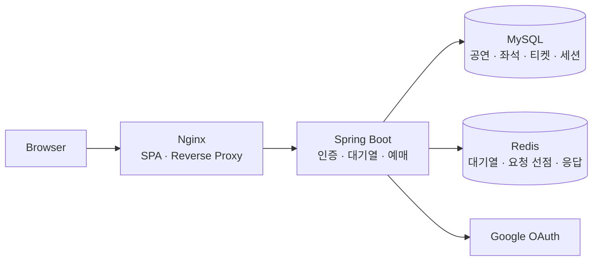

# 🎟️ Book Tickets

> 예매 오픈에 몰리는 요청을 대기열로 제어하고, 동시 구매와 응답 유실 상황에서도 구매 결과의 정합성을 지키는 공연 예매 서비스

티켓팅을 하며 접한 “이미 선택된 좌석”과 오픈 직후의 대기열이 어떻게 동작하는지 궁금해 시작한 개인 프로젝트입니다. 1차 구현 이후 설계와 코드를 다시 비교하고, **예매 정합성 → 인증 → 대기열 → 부하·장애 검증** 순서로 재구축했습니다.

| 항목 | 내용 |
| --- | --- |
| 개발 기간 | 1차 구현 2026.04~05 · 리팩토링 및 추가 구현 2026.10 |
| 참여 인원·담당 | 1인 · 설계, 백엔드, DB, 프론트엔드, 테스트, 배포 자동화 |
| 중점 | 중복 요청 제어, 다중 좌석 원자 구매, 대기열 진입 통제, 실패 후 재시도 |

**대표 검증 결과**

- **같은 좌석에 1,000명 경합:** 세 락 전략 각각 3회 측정에서 성공 1건, 티켓 1장.
- **전략별 10회 비교 후 기본값 결정:** 지연과 판매 결과, 구현 복잡도를 함께 고려해 비관적 락 선택.
- **장애 3종 검증:** 분산 락 lease 만료, Redis 중단, 구매 커밋 직후 응답 유실을 주입해 정합성과 재시도 결과 확인.

측정값은 단일 로컬 환경의 결과입니다. 조건과 해석 범위는 [측정과 기술 결정](#측정과-기술-결정), 테스트별 검증 범위는 [검증 범위](#검증-범위)에 정리했습니다.

[프로젝트 소개](#프로젝트-소개) · [기술과 구조](#기술과-구조) · [핵심 구현](#핵심-구현) · [측정과 기술 결정](#측정과-기술-결정) · [검증 범위](#검증-범위) · [배포와 남은 과제](#배포와-남은-과제)

## 프로젝트 소개

사용자는 공연을 조회하고 Google 계정으로 로그인한 뒤, 공연별 대기열을 거쳐 좌석을 구매합니다. 아티스트는 공연을 등록할 수 있으며, 공연 생성 시 구역·행·열 기준으로 15,000석을 자동 생성합니다.

```text
공연 조회 → Google 로그인 → 대기열 등록 → 입장 허가 → 입장
          → 구역·좌석 선택 → 1~4매 구매 → 내 티켓 확인
```

- 비회원도 공연 목록과 상세를 조회할 수 있습니다.
- 신규 회원은 `FAN`입니다. 아티스트 승격 UI·API는 없어 `ARTIST` 역할은 DB에서 지정합니다.
- 한 번의 구매에서 같은 공연의 좌석 1~4매를 함께 처리하며, 공연당 1인 누적 구매 한도는 4매입니다.
- 구매가 성공하면 입장 권한을 소진하고 자리를 반환합니다. 추가 구매는 대기열 맨 뒤에 다시 등록합니다.
- 좌석 경쟁으로 구매가 실패하면, 남은 입장 시간 안에서 다른 좌석을 선택할 수 있습니다.
- 결제는 **Mock 결제**입니다. 실제 PG, 취소·환불, 좌석을 일정 시간 선점하는 기능은 구현 범위에서 제외했습니다.

### 기존 프로젝트에서 바꾼 것

1차 구현에서는 구역별 좌석 조회와 세 가지 락 전략을 구현했습니다. 이후 테스트가 통과하는 코드도 설계와 다르거나 실제 Redis·MySQL에서 검증되지 않은 부분이 있다는 것을 확인해, 기능 추가와 결함 수정을 함께 진행했습니다.

| 영역 | 1차 구현 | 현재 구현 |
| --- | --- | --- |
| 좌석 조회·생성 | 구역 요약·선택 구역 조회, 중복 집계 제거, 좌석 생성은 JPA 건별 INSERT | 조회 구조 유지, 좌석 생성은 JDBC batch 적용 |
| 구매 단위 | 좌석 1매, 1인 구매 한도 없음 | 같은 공연 1~4매 원자 구매, 공연당 누적 4매 |
| 멱등성 | Redis 조회 → 구매 → 응답 저장 | 원자적 요청 선점·본문 비교·DB 구매 결과 복구 |
| 인증 | 이메일 로그인, 토큰을 localStorage에 보관 | Google OAuth, RS256, 메모리 Access Token(AT)·HttpOnly Refresh Token(RT), Rotation·재사용 탐지 |
| 구매 진입 | 로그인 후 구매 API 호출 | 대기열 입장 권한 검증·1회용 소진 |
| 시간·스키마 | LocalDateTime, Hibernate 스키마 자동 변경 | UTC Instant·주입된 Clock, Flyway·스키마 검증 |
| 검증 | H2·인메모리 테스트 중심 | 실제 MySQL·Redis 통합 테스트, 부하 측정, 장애 주입 |


## 기술과 구조

| 영역 | 기술 | 사용 목적 |
| --- | --- | --- |
| Backend | Java 25, Spring Boot 4.0.5, Spring Security, Spring Data JPA | API, 인증·권한, 구매 트랜잭션 |
| Database | MySQL 8, Flyway | 좌석·티켓·세션 저장, 무결성 제약, 스키마 이력 |
| Redis | Redis 7.2, Lua, Redisson 3.51 | 대기열 상태 전이, 멱등성 선점, 분산 락 비교 |
| 인증 | Google OAuth, RS256 JWT, JWKS | 로그인, 공개키 기반 토큰 검증, 입장 권한 분리 |
| Frontend | React 19, TypeScript 5.9, Vite 7 | 대기열·좌석 선택·구매 화면 |
| 검증 | JUnit, Testcontainers, k6, Vitest, Playwright | 경계값·동시성·부하·장애·화면 흐름 검증 |
| 배포 | Docker Compose, Nginx, GitHub Actions, GHCR | 이미지 빌드, 스모크 검사, 롤백 자동화 |



백엔드는 **하나의 Spring Boot 애플리케이션**입니다. MySQL에는 확정된 구매 결과를 저장하고, Redis에는 대기열과 요청 처리 상태를 저장합니다. 로그인 토큰과 Entry Token은 서로 다른 RSA 키쌍으로 서명합니다.

## 핵심 구현

### 1. 같은 구매 요청을 한 번 처리하고, 응답을 잃어도 결과를 복구

기존 멱등성 처리는 Redis에서 키를 조회한 뒤 구매하고 응답을 저장했습니다. 조회와 저장 사이에 같은 키의 요청이 들어오면 둘 다 처리될 수 있었고, 같은 키로 다른 좌석을 요청해도 이전 응답이 반환됐습니다. 구매가 DB에 커밋된 뒤 Redis 저장이 실패하면 성공한 구매가 500 응답으로 바뀌는 문제도 있었습니다.

이를 다음과 같이 변경했습니다.

1. Redis Lua로 `IN_PROGRESS`를 원자적으로 선점합니다. 완료·해제는 선점한 요청의 owner가 일치할 때만 수행합니다.
2. 좌석 ID 목록을 정렬해 SHA-256 해시로 비교합니다. 같은 키·다른 좌석 조합은 `422 IDEMPOTENCY_CONFLICT`, 처리 중인 요청은 `409 REQUEST_IN_PROGRESS`입니다.
3. **구매 트랜잭션의 커밋과 후속 Redis 처리를 분리**합니다. 커밋 후 응답 저장·입장 권한 정리·분산 락 해제 오류가 확정된 구매를 실패로 바꾸지 않도록 합니다.
4. Redis 기록이 없어지면 같은 사용자·구매 키의 티켓 묶음을 DB에서 조회해 기존 성공 응답을 재구성합니다.

```text
요청 선점 → DB 구매 트랜잭션 → 커밋 → 입장 권한 소진·응답 저장
               ↑                         실패해도 구매 성공 유지
      Redis 기록 유실 시 동일 구매 묶음으로 응답 복구
```

성공 응답 재전송과 DB 복구는 Entry Token 재검증보다 먼저 처리합니다. 구매 성공 시 토큰을 이미 소진하므로, 재시도에 새 입장 권한을 요구하면 응답 복구가 막히기 때문입니다. **새로운 구매**는 반드시 입장 권한 검증을 거칩니다.

프론트엔드도 네트워크 오류·5xx 이후 같은 구매 시도에는 같은 멱등성 키를 유지합니다. 다만 응답 저장 실패 후 `IN_PROGRESS`가 남아 있으면 최대 30초 동안 409가 반환될 수 있습니다.

### 2. 여러 좌석 구매의 원자성과 누적 구매 한도 보장

구매 API는 `POST /api/tickets`이며, `{ "seatIds": [123, 124] }` 형식의 본문과 `Authorization: Bearer <AT>`, `X-Entry-Token`, `Idempotency-Key` 헤더를 받습니다.

같은 공연의 좌석 1~4매를 한 트랜잭션으로 처리합니다. 한 좌석이라도 판매됐거나 Mock 결제가 실패하면 좌석 상태 변경과 티켓 생성을 모두 롤백합니다.

기본 비관적 락 전략의 DB 트랜잭션:

```text
사용자 행 잠금 → 좌석 ID 오름차순 조회·잠금 → 누적 4매·판매 기간 확인
              → 모든 좌석 SOLD 변경·flush → 합산 Mock 결제 → 티켓 생성 → 커밋
```

| 보호 장치 | 지키는 규칙 |
| --- | --- |
| `users` 행 잠금 | 같은 사용자의 동시 요청이 누적 4매 한도를 넘지 않도록 직렬화 |
| 좌석 ID 오름차순 접근 | 겹치는 좌석 묶음도 같은 잠금 순서로 처리 |
| 비관적·낙관적·분산 락 전략 | 서로 다른 사용자의 좌석 경쟁 제어, 설정으로 전략 교체 |
| 좌석 `@Version` | 버전이 바뀐 좌석의 갱신 거부 |
| `uq_ticket_seat` | 좌석당 티켓 1장이라는 DB 무결성 보장 |
| `purchase_key`·`admission_id` 기록 | 같은 구매 응답 복구, 이미 사용한 입장 회차의 신규 구매 거부 |

JPA의 `IDENTITY` 키 생성에서는 티켓 INSERT가 좌석 UPDATE보다 먼저 실행될 수 있었습니다. 이 순서에서는 낙관적 충돌보다 티켓 유니크 위반이 먼저 발생합니다. 좌석 UPDATE를 명시적으로 flush한 뒤 결제·티켓 생성을 수행하도록 바꿔, 경쟁에서 진 요청이 결제 전에 실패하게 했습니다.

기존에도 좌석 유니크 제약은 있었습니다. 이번 작업은 그 제약을 유지하면서 요청 선점, 잠금 순서, 구매 한도와 응답 복구를 보강한 것입니다.

### 3. 대기열을 통과한 사용자의 구매만 허용

대기열의 순번과 만료 시각을 Redis Sorted Set에 저장하고, 등록·입장·만료 정리를 Lua로 원자 처리합니다. 상태 조회는 사용자·공연을 매번 DB에서 확인하지 않고 Redis 한 번의 왕복으로 처리합니다.

```text
WAITING ── Worker의 입장 허가 ──▶ ADMITTED ── 사용자의 입장 요청 ──▶ ACTIVE
  순번별 폴링                       60초 안에 입장                   최대 5분
                                                                     │
                                              구매 성공: 권한 소진·자리 반환
                                              구매 실패: 남은 시간 내 재선택
```

| 항목 | 현재 설정·규칙 |
| --- | --- |
| 공연별 수용량 | `ADMITTED + ACTIVE ≤ 1,000` · 전체 대기자 수의 상한은 아님 |
| 입장 Worker | 실행 완료 후 5초 간격, 빈자리 범위에서 주기당 최대 100명 |
| WAITING 폴링 | 순번 1~100: 3초 / 101~1,000: 10초 / 1,001 이상: 20초 · 응답에는 ±20% jitter 적용 |
| Entry Token | 사용자·공연·입장 회차·만료를 검증, Redis에서 구매 권한 선점 |
| 구매 성공 | Entry Token 1회용 소진, ACTIVE 자리 반환 |
| 유효 ACTIVE의 대기 취소 | 거부 · 권한이 남아 있는데 자리를 다시 배정하는 문제 방지 |

프론트엔드는 서버의 폴링 간격을 따르고 요청을 중첩하지 않습니다. 남은 입장 시간은 응답의 서버 시각으로 보정합니다. Access Token 문제는 401, Entry Token 문제는 403으로 구분해 입장 권한 만료를 로그인 갱신으로 처리하지 않도록 했습니다.

**현재 Worker는 단일 백엔드 인스턴스를 전제로 합니다.** 여러 인스턴스에서 Worker가 실행되면 주기당 입장 속도가 달라지므로 다중 인스턴스 운영은 별도 검증이 필요합니다.

### 4. 인증·시간·조회 규약 정리

| 영역 | 구현과 해결한 문제 |
| --- | --- |
| 토큰 보관 | AT·Entry Token은 메모리, 난수 RT는 HttpOnly Cookie. DB에는 RT 원문 대신 SHA-256 해시 저장 |
| RT Rotation | Session → RT 순서로 잠금, 기존 RT 소비 후 새 RT 생성. 동시 refresh 10건에서도 성공 1건 |
| RT 재사용 탐지 | 소비 후 15초 이내 재제출은 재시도 유예, 이후는 Session revoke. revoke를 커밋한 뒤 401 응답 |
| DB 제약 | 생성 컬럼과 UNIQUE로 세션당 미사용 RT 최대 1개 보장 |
| 시간 | UTC `Instant`·주입된 `Clock`, 판매 가능 범위 `open ≤ now < close`, DB `DATETIME(6)` 정밀도에 맞춤 |
| 좌석 조회 | 구역별 잔여 수만 집계해 전체 잔여 수를 합산하고, 좌석 목록은 선택 구역 단위로 조회 |
| 좌석 생성 | JPA 건별 INSERT를 JDBC batch 1,000건 단위로 변경, 공연 생성과 같은 트랜잭션 유지 |
| 스키마 | Flyway V1/V2로 변경 이력을 관리하고 `ddl-auto: validate`로 매핑 불일치 확인 |

로그아웃과 RT 재사용 탐지는 이후 refresh를 차단합니다. 이미 발급된 AT를 즉시 폐기하는 블랙리스트는 없으며, AT의 수명은 15분입니다.

## 측정과 기술 결정

### 락 전략: 첫 측정 결과를 반복 측정으로 다시 확인

비관적·낙관적·분산 락을 동일 조건에서 비교했습니다. 처음에는 전략별 3회 측정에서 분산 락의 지연이 낮았지만, 회차별 변동을 확인하고 핫 구역 시나리오를 **전략별 10회**로 늘렸습니다. 실행 순서는 회차마다 바꿨습니다.

**조건:** 서로 다른 사용자 1,000명, HOT 구역 300석, 고정 시드로 1~4매 요청, 사용자당 첫 시도 1회, 재시도 없음. p95는 성공·실패를 포함한 구매 HTTP 응답이며 대기열 준비 시간은 제외합니다.

| 전략 | 회차별 판매 좌석 수의 평균 | 회차별 구매 p95의 평균 |
| --- | ---: | ---: |
| 비관적 락 | 262.4석 | 6.93s |
| 낙관적 락 | 260.5석 | 6.39s |
| 분산 락 | 245.4석 | 5.81s |

분산 락은 사전에 정한 **p95 20% 이상 감소** 조건을 충족하지 못했습니다. 단일 인스턴스에서 Redis 락·lease 관리를 추가하지 않아도 되는 단순성을 함께 고려해 **비관적 락을 기본값**으로 선택했습니다. `TICKET_PURCHASE_STRATEGY`로 세 전략을 교체할 수 있습니다.

비관적·낙관적 락의 판매 좌석 차이는 통계적으로 구분되지 않았습니다. 분산 락의 낮은 판매 수는 락 획득 실패 뒤 재시도하지 않는 이번 조건의 영향일 수 있어 실제 사용의 최종 판매량으로 일반화하지 않았습니다.

별도로 **1,000명 → 같은 1석** 시나리오를 세 전략 각각 3회 실행했고, 모든 회차에서 성공 1건·티켓 1장을 확인했습니다. 전략 측정은 총 39회입니다.

상세: [락 전략 비교 결과](backend/loadtest/results/strategy_comparison.md)

### 대기열: 구매 지연과 입장 속도를 함께 확인

총 2,000명이 시간차로 도착해 등록 → 상태 조회 → 입장 → 좌석 조회 → 생각 시간 75~90초 → 고유 좌석 1매 구매를 수행하는 시나리오로 측정했습니다. 수용량·주기당 입장 인원 7조합을 탐색하고, 경계 2조합을 추가 반복해 총 11회 실행했습니다.

| 유지한 설정 | 구매 API p95 | 입장 API p95 | 구역 좌석 조회 p95 | 구매 결과 |
| --- | ---: | ---: | ---: | ---: |
| 수용량 1,000 / 주기당 100명 | 44.58ms | 19.18ms | 30.44ms | 2,000/2,000 성공 |

주기당 200명 입장에서는 입장 p95가 0.8~1.2초로 증가했습니다. 목표 규모와 입장·조회 지연을 함께 고려해 **1,000/100을 유지**했습니다. 이 설정 자체는 1회 측정이므로 운영 환경에서 반복 측정이 필요합니다.

위 값은 대기시간을 포함한 전체 예매 소요 시간이 아닙니다. 락 경쟁 실험과도 인원·도착 패턴·좌석 경쟁 조건이 달라, 두 결과를 전후 성능 개선율로 비교하지 않았습니다. 등록 API p95 1.3~2.0초는 남은 병목입니다.

상세: [대기열 수치 측정 결과](backend/loadtest/results/queue_numbers.md)

### 인덱스: 효과가 작으면 추가하지 않는 선택

20개 공연·30만 좌석·기존 티켓 38,000건에서 베이스라인과 후보 인덱스 3종을 각각 3회 비교했습니다. `EXPLAIN ANALYZE`, API 지연과 구매 처리량을 함께 확인했습니다.

| 후보 | 관찰 | 결정 |
| --- | --- | --- |
| 좌석 `(concert_id, status)` | 구역 집계 p95 약 7%·AVAILABLE 조회 약 4.2% 감소, 구매 TPS 약 3.3% 감소 | 사전 조회 개선 기준 10% 미달로 보류 |
| 티켓 `(user_id, created_at)` | 내 티켓 조회 개선 효과 없음 | 보류 |
| 공연 판매 기간 인덱스 | 현재 API에 해당 조건의 조회 쿼리가 없음 | 보류 |

세 후보 모두 채택하지 않았습니다. 조회 성능의 작은 이득과 인덱스의 저장·쓰기 비용을 비교한 결과이며, 이를 위한 Flyway V3도 추가하지 않았습니다.

상세: [인덱스 비교 결과](backend/loadtest/results/index_comparison.md)

### 장애 주입: 커밋된 구매 결과가 실패로 바뀌는지 확인

| 주입한 장애 | 확인한 결과 |
| --- | --- |
| 분산 락 lease 만료 | 경쟁 요청 중 성공 1건·티켓 1장 유지, DB 제약 위반은 409 응답 |
| Redis 중단·재시작 | 중단 중 신규 구매는 500. 재시작 후 같은 키로 기존 성공 결과 복구 |
| 커밋 직후 응답 유실 | 같은 키 재전송으로 동일 201 응답, Redis 멱등성 기록 삭제 후에도 DB 구매 묶음 복구 |

측정마다 좌석 중복, SOLD·티켓 상태 불일치, 누적 4매 초과, 부분 구매를 검사했습니다. 확인한 위반은 0건입니다.

**공통 측정 환경:** WSL2 8코어·16GB, 단일 JVM·heap 1GiB, Hikari 10, Tomcat 최대 200 threads, Docker MySQL 8.0.36·Redis 7.2.4. k6·앱·DB를 같은 머신에서 실행했고 운영 부하 측정은 수행하지 않았습니다.

상세: [장애 주입 결과](backend/loadtest/results/fault_injection.md) · [측정 도구와 재현 방법](backend/loadtest/README.md)

### 검증 범위

아래는 **2026-10-09 기준 최종 검증 기록**입니다.

| 검증 | 기록 | 확인 범위 |
| --- | ---: | --- |
| Backend 단위·API 테스트 | 222건 통과 | 판매·시간 경계, 오류 계약, 멱등성, 토큰, 구매 정책 |
| Backend 통합 테스트 | 75건 통과 | 실제 MySQL·Redis·Redisson, Lua·락·DB 제약·RT 경쟁 |
| Frontend Vitest | 95건 통과 | 토큰 갱신, 폴링, 서버 시각 보정, 구매 키 재사용 |
| Frontend Playwright | 6건 통과 | API 모킹 기반 브라우저 흐름 · 실제 서버 통합 E2E와 구분 |
| 배포 스크립트 테스트 | 6건 통과 | HTTP 모의 서버를 포함한 스모크·실패·롤백 분기 |
| 실제 서버 수동 확인 | 수행 기록 있음 | 로컬 Google 로그인·refresh·로그아웃·탈퇴·대기열·구매 |

H2·인메모리 테스트만으로는 실제 Redis Lua와 MySQL 잠금 동작을 확인할 수 없어 통합 테스트를 분리했습니다.

## 배포와 남은 과제

### 배포 이력

1차 구현에서는 배포 경험을 목적으로 AWS에 서비스를 올려 GitHub Actions 배포까지 검증했습니다. 현재 AWS 리소스는 모두 정리한 상태입니다.

```text
ALB → EC2(Docker Compose: Nginx · Spring Boot) → RDS MySQL · ElastiCache Valkey
```

당시 파이프라인은 main push 시 테스트 → GHCR 이미지 게시 → EC2에서 Compose 교체로 끝났습니다. 교체 직후 이전 이미지를 정리했고, 새 버전이 정상 응답하는지 확인하거나 실패 시 이전 버전으로 되돌리는 단계는 없었습니다.

### 이번에 보강한 배포 파이프라인

같은 인프라를 다시 올리는 대신, 1차 파이프라인에 없던 배포 검증과 실패 대응을 추가했습니다.

| 영역 | 1차 구현 | 현재 구현 |
| --- | --- | --- |
| 배포 전 검증 | 백엔드 단위 테스트, 프론트엔드 테스트·빌드 | 백엔드 통합 테스트 추가 |
| 배포 후 확인 | 없음 | 실행 이미지 SHA 확인, 스모크 6종 |
| 실패 대응 | 없음 | 이전 이미지·환경으로 자동 롤백 후 실패 종료 |
| 재배포 | 새 commit 빌드만 가능 | 기존 commit SHA 지정 재배포·수동 롤백 |
| 이미지 정리 | Compose 교체 직후 | 스모크 통과 후 |
| 트리거 | main push 자동 배포 | 운영 환경이 없어 수동 실행(`workflow_dispatch`)만 |

```text
검증 → GHCR 이미지 빌드·SHA/latest 태그 게시 → EC2에서 이미지 pull·Compose 교체
     → 실행 이미지 SHA 확인 → 스모크 6종 → 성공 시 태그 없는 이미지 정리
                              └ 실패 시 이전 배포가 있으면 이미지·환경 롤백 후 실패 종료
```

스모크 대상은 health, SPA, 공연 목록, 로그인 JWKS, 대기열 JWKS, RT 없는 refresh의 401 JSON 응답입니다. 롤백은 앱 이미지와 환경을 복구하며 DB 마이그레이션을 되돌리지 않습니다. 첫 배포에는 이전 환경이 없어 자동 롤백할 수 없습니다.

[CI](.github/workflows/ci.yml)는 PR·main push에서 백엔드 단위·통합 테스트, 프론트엔드 테스트·빌드, 배포 스크립트 테스트와 Docker 이미지 빌드를 수행합니다. Playwright는 현재 CI에 포함되지 않습니다. 배포 워크플로는 [Deploy](.github/workflows/deploy.yml)입니다.

배포·스모크·롤백 스크립트의 성공·실패·롤백 분기는 모의 HTTP 서버와 명령 스텁을 사용한 테스트로 검증했습니다. **보강한 파이프라인을 실제 AWS 환경에서 실행하지는 않았습니다.** 운영 Compose는 단일 backend·nginx와 외부 MySQL·Redis/Valkey를 사용하도록 구성했습니다.

<details>
<summary>운영 연결에 필요한 설정</summary>

| GitHub Secrets | 용도 |
| --- | --- |
| `EC2_HOST`, `EC2_USER`, `EC2_SSH_KEY` | EC2 SSH 접속 |
| `REGISTRY_USERNAME`, `REGISTRY_TOKEN` | GHCR 이미지 pull |
| `SPRING_DATASOURCE_URL`, `SPRING_DATASOURCE_USERNAME`, `SPRING_DATASOURCE_PASSWORD` | 외부 MySQL, UTC JDBC 설정 |
| `SPRING_DATA_REDIS_HOST`, `SPRING_DATA_REDIS_PORT`, `SPRING_DATA_REDIS_SSL_ENABLED` | 운영 Redis/Valkey 접속·TLS |
| `JWT_PRIVATE_KEY_PEM`, `JWT_PUBLIC_KEY_PEM`, `JWT_KEY_ID`, `JWT_ISSUER`, `JWT_AUDIENCE` | 운영 로그인 키·검증 설정 |
| `QUEUE_JWT_PRIVATE_KEY_PEM`, `QUEUE_JWT_PUBLIC_KEY_PEM`, `QUEUE_JWT_KEY_ID` | 로그인과 별도인 운영 Entry Token 키 |
| `GOOGLE_CLIENT_ID`, `GOOGLE_CLIENT_SECRET`, `GOOGLE_REDIRECT_URI` | 운영 OAuth 설정 |
| `TICKET_PURCHASE_STRATEGY` | 비우면 `pessimistic` |

수동 롤백의 검사가 실패하면 자동으로 원래 이미지로 되돌리지 않고 실패 종료합니다. 운영 쿠키의 Secure 설정은 애플리케이션 기본값 `true`를 사용합니다. 운영 연결 시 TLS 종료·프록시 전달, 빈 DB의 Flyway 적용, Redis 내구성·데이터 유실 정책, backend 단일 인스턴스와 배포·롤백 동작을 확인해야 합니다. 로컬 키를 운영 키로 재사용하지 않습니다.

</details>

### 남은 과제와 배운 점

- **운영 검증:** 로컬 측정 도구와 서버가 자원을 공유하므로, 운영 구성에서 부하 발생기를 분리해 재측정해야 합니다. 보강한 파이프라인의 실제 환경 배포·롤백 리허설과 모니터링·알림도 후속 과제입니다.
- **남은 병목:** 대기열 등록의 DB 확인과 좌석 가용 조회 비용이 남아 있습니다. 조회 캐시 등은 별도 실험 대상으로 보류했습니다.
- **장애 범위:** Redis 중단 중 신규 구매는 실패합니다. 커밋된 구매의 응답 복구와 서비스 가용성은 별도로 다뤄야 합니다.
- **보류 사항:** 일부 Google 프로필 입력 처리의 경미한 리뷰 항목이 남아 있습니다.

이번 작업에서는 테스트 개수보다 **무엇을 검증하지 못하는지**를 먼저 확인하게 됐습니다. 실제 DB·Redis에서 경쟁을 재현하고, 측정 조건과 선택 기준을 남기며, 작은 성능 차이만으로 기술을 추가하지 않는 과정을 경험했습니다.

## 저장소 안내

```text
backend/
  src/main/java/.../domain/    auth · concert · seat · ticket · queue · user
  src/main/java/.../infra/     Redis · Redisson · Google · Mock 결제
  src/main/resources/         설정 · Flyway · 대기열 Lua
  src/test/                   단위·API 테스트
  src/integrationTest/        실제 MySQL·Redis 통합 테스트
  loadtest/                   k6·장애 주입 도구·측정 결과
frontend/                     React 화면·Vitest·Playwright
.github/                      CI·배포 워크플로·배포 스크립트
nginx/                        SPA·API 프록시 설정
Dockerfile.*                  backend·nginx 이미지
```

실행하려면 MySQL·Redis, Google OAuth 클라이언트, RSA 키쌍 2개가 필요합니다. 환경변수는 [.env.example](.env.example)을 참고하고, `./gradlew bootRun`(backend)과 `npm run dev`(frontend)로 실행합니다.

<details>
<summary>API 요약</summary>

| 영역 | Method · Path | 인증 | 설명 |
| --- | --- | --- | --- |
| 인증 | `GET /api/auth/google/login` · `GET /api/auth/google/callback` | 없음 | Google 로그인 시작·콜백, RT Cookie 발급 |
| 인증 | `POST /api/auth/refresh` · `POST /api/auth/logout` | RT Cookie | AT 재발급·RT Rotation, 세션 종료 |
| 인증 | `GET /.well-known/jwks.json` | 없음 | 로그인 토큰 공개키 |
| 회원 | `GET /api/users/me` · `DELETE /api/users/me` | AT | 내 정보, 회원 탈퇴 |
| 공연 | `GET /api/concerts` · `GET /api/concerts/{concertId}` | 없음 | 공연 목록·상세 |
| 공연 | `POST /api/concerts` | AT(ARTIST) | 공연 등록, 좌석 15,000석 생성 |
| 좌석 | `GET /api/concerts/{concertId}/seats/availability` | 없음 | 구역별 잔여 수 요약 |
| 좌석 | `GET /api/concerts/{concertId}/seats/availability/sections/{section}` | 없음 | 선택 구역 좌석 목록 |
| 대기열 | `POST /api/queue/{concertId}` · `GET /api/queue/{concertId}/status` | AT | 대기열 등록, 순번·폴링 간격 조회 |
| 대기열 | `POST /api/queue/{concertId}/enter` · `DELETE /api/queue/{concertId}` | AT | 입장(Entry Token 발급), 대기 취소 |
| 대기열 | `GET /api/queue/.well-known/jwks.json` | 없음 | Entry Token 공개키 |
| 티켓 | `POST /api/tickets` | AT + `X-Entry-Token` + `Idempotency-Key` | 좌석 1~4매 구매 |
| 티켓 | `GET /api/tickets/me` | AT | 내 티켓 조회 |

</details>

[백엔드 도메인 코드](backend/src/main/java/com/project/ticket/domain) · [프론트 API 클라이언트](frontend/src/api.ts) · [환경변수 예시](.env.example) · [운영 Compose](docker-compose.prod.yml) · [측정 결과](backend/loadtest/results)
